

# TSG Hub

**Clan events for TypeShii Gaming, right in your RuneLite sidebar.**

Join a bingo team, climb the Skill of the Week leaderboard, find a raid party, and let the plugin track your progress while you play.

[Getting started](#getting-started) · [Features](#features) · [Discord](#link-your-discord) · [Admins](#for-admins) · [Privacy](#privacy)

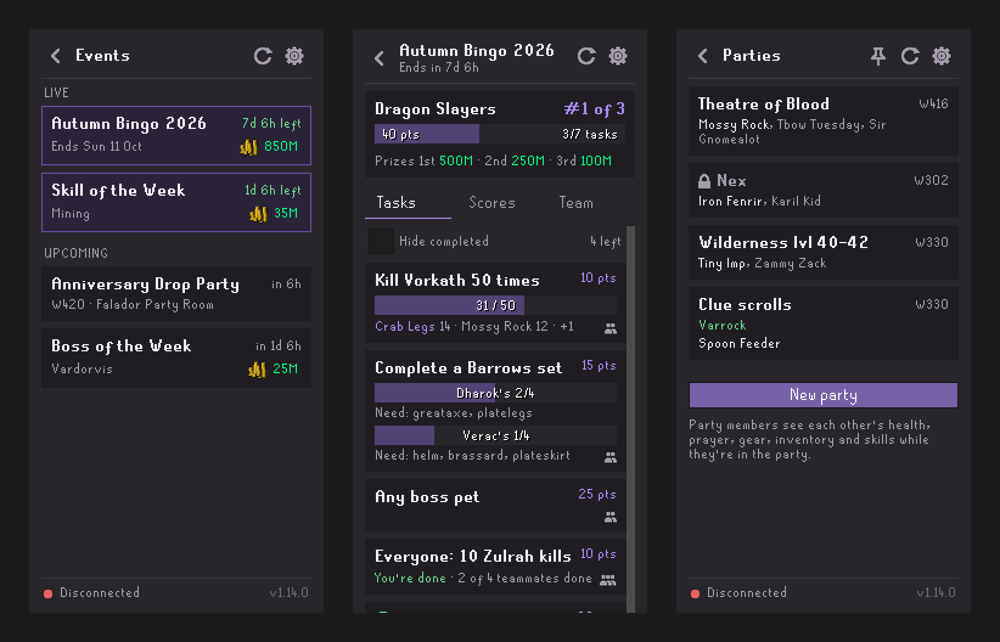

> **Members only.** TSG Hub only works for members of the **TSGaming** clan. Anyone else sees a members-only message, and nothing is sent.

## Getting started

1. Install **TSG Hub** from the Plugin Hub.
2. Log in to a character in the TSGaming clan and open the TSG Hub sidebar.
3. Click **Enable sharing**. Nothing is sent until you do.
4. Pick an event. For bingo, enter the team code an admin gave you, or [sign up](#sign-up-without-a-team) if the bingo takes sign-ups. Your team is fixed once you join.

<table align="center"><tr><td align="center" valign="top">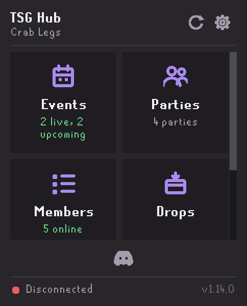 Home</td><td align="center" valign="top">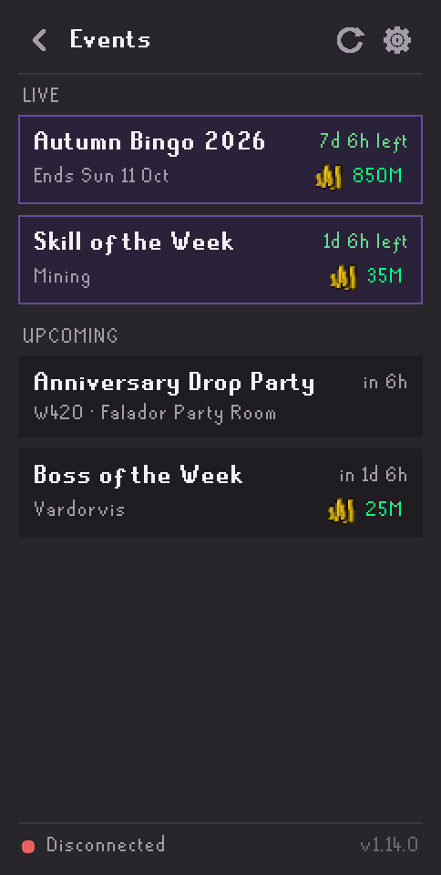 Events</td></tr></table>

**Disconnect from event** on the **Team** tab stops tracking on this device. Your team keeps its progress, and you can rejoin with the same code.

## Features

| Feature | What it does |
|---|---|
| 🎯 **[Bingo](#bingo)** | Team boards that update automatically from kills, drops, raids and collection log unlocks |
| 🏆 **[Competitions](#competitions-and-custom-events)** | Skill of the Week and Boss of the Week leaderboards you join with one click |
| 📣 **[Custom events](#competitions-and-custom-events)** | Drop parties, clan trips and more, announced with the time, world and location |
| 💰 **Prizes** | Optional GP prizes for 1st, 2nd and 3rd place |
| ⚔️ **[Clan parties](#clan-parties)** | Raids, bossing and skilling. One-click join, no passphrase, live health, prayer, gear, inventory and skills |
| 👥 **[Members](#members)** | Which clanmates are online, their world, area and what they're doing |
| 💎 **[Drops](#drops)** | The clan's big drops, raid loot, pets and collection log items, so you can catch up |
| 📰 **[News](#news)** | Announcements from the admins, in the sidebar and your chatbox |
| 📌 **[Split view](#split-view)** | Pin Members, Parties or Drops below the main view |
| 🔗 **[Discord linking](#link-your-discord)** | Link your RuneScape account to the clan Discord |
| 🛠️ **[Admin tools](#for-admins)** | One click to the admin site, plus member notes and warnings in the sidebar |

---

## Bingo

Your team's board opens straight from the sidebar. The header shows your team's rank, points and tasks done, plus the prize for each place. Every task shows its points, a progress bar, and who contributed what. Open tasks sort first; tick **Hide completed** to focus on what's left.

**Scores** ranks every team, and **Team** lists your teammates. The board updates live while it's open.

**Claim a tile** to tell your team you're going for it: right-click an open task and pick **Claim tile**, with an optional note such as "doing it tonight" (up to 100 characters). Each task shows who on your team has claimed it, and hovering it shows their notes. Tiles you've claimed are highlighted. Right-click again to **Change note** or **Drop claim**. Several teammates can claim the same tile, and only your team sees your claims. Claims clear when your team completes the tile or you disconnect from the event.

When you make progress, a message appears in **your own chatbox only**. When your team finishes a tile, teammates who are online in clan chat get a local alert too. TSG Hub never posts to public or clan chat.

<table align="center"><tr><td align="center" valign="top">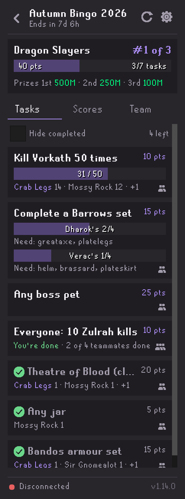 Tasks</td><td align="center" valign="top">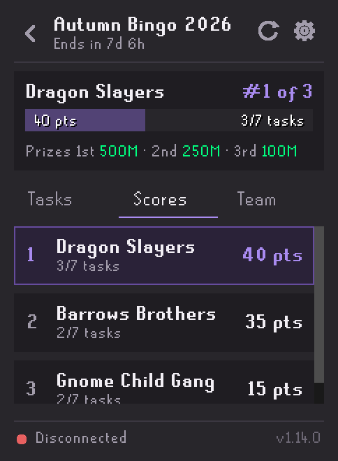 Scores</td><td align="center" valign="top">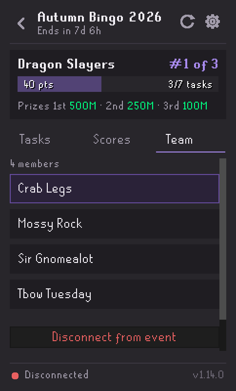 Team</td></tr></table>

### Sign up without a team

If an admin turns on sign-ups for a bingo, its page shows **Sign up for a team** with how many members are waiting and when sign-ups close. Add an optional note, such as when you can play (up to 200 characters), and click **Sign up**. While you wait, the bingo shows **Signed up, waiting for a team** with your note; **Edit note** changes it while sign-ups are open, and **Withdraw** takes you out of the pool. When an admin puts you on a team from the admin site, the bingo switches to your team's board, live if you have it open. No team code is needed, and progress only counts once you're on a team. Team codes keep working alongside sign-ups.

### What gets tracked

| Task type | How it's tracked |
|---|---|
| **Boss kills** | The in-game kill count message, or loot drops for bosses without one |
| **Item drops** | Any listed item from NPC loot, matched by RuneLite item ID |
| **Item sets** | Every piece of a set, such as Barrows or Bandos. Teammates can each find different pieces |
| **Any jar / Any boss pet** | Built-in groups, so admins don't have to list every item |
| **Raids** | Chambers of Xeric, Theatre of Blood, Tombs of Amascut and The Fractured Archive completions, per mode. Optionally clan-only; a clan-only completion where the plugin can't see who was in the raid doesn't count |
| **Collection log** | New collection log unlocks count toward set tasks |

Tasks can be **Team** (everyone's progress pools together), **Everyone** (each member reaches the target), or **Solo** (one member does it alone).

## Competitions and custom events

**Skill of the Week** tracks the XP you gain in one skill. **Boss of the Week** counts kills of one boss. Click the event, press join, and play: your gain and rank update as you go.

**Custom events**, like drop parties, show when and where they happen, along with the host and any notes.

The **Events** list splits live and upcoming events, with each one's prize pool. Open an event to see the prize for each place.

Every event shows its start and end in your own time zone, with the zone name (for example "Mon 5 Oct, 7pm AEDT") and how long until it starts or ends. Competitions count gains made between those exact times, wherever you are.

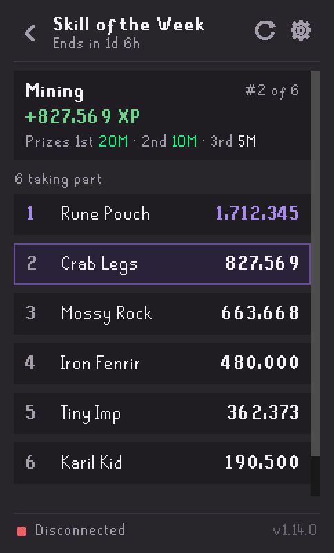

## Clan parties

The **Parties** section lists every open party in the clan, with its title, world and members. Click one to join, or start your own. A new party is titled by where its members are, like `Theatre of Blood` or `Wilderness lvl 40-42`, until a title is set. The leader can use **Lock party** to stop anyone else joining.

There's no passphrase to share. Once you're in, each member's panel shows their health, prayer, special attack, run energy, gear, inventory, skills and active prayers, live over RuneLite's party connection. Right-click a member to move them up or down your list.

A party closes when its last member leaves. Members drop out after 3 minutes without checking in, or after 30 minutes at the login screen.

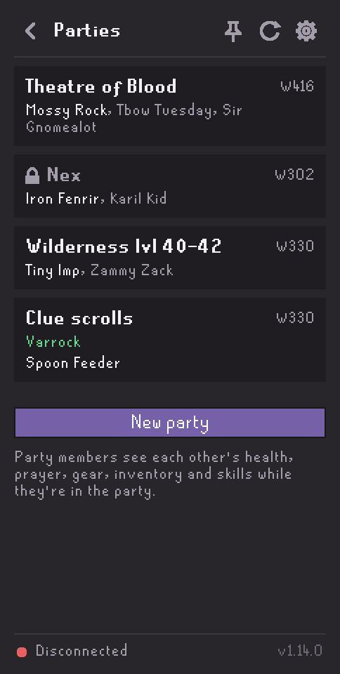

## Members

The **Members** section lists clanmates who are in clan chat with sharing on. Each row shows their world, area and what they're doing, such as `Mining · Motherlode Mine`, `Vorkath` or `Chambers of Xeric`. Clanmates on your world have their world shown in green.

Activity is detected automatically from where you are and the XP you gain.

Anyone in clan chat with sharing on appears in the list. Your area and activity are only shown if you turn on **Share location and activity** under **Sharing** in the plugin settings; otherwise clanmates just see **Online** and your world, the same as clan chat shows. Leave clan chat to hide yourself, and you also drop off the list when you log out.

Online clanmates are listed first, including those in clan chat without TSG Hub, who show just their world. The rest of the clan is listed under **Offline**; tick **Show offline** to expand it. Offline members who use TSG Hub show how long ago they were last online.

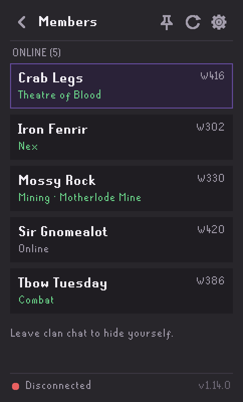

### World map

Clanmates who share their location show on your world map with their name. Members close enough to overlap merge into one marker such as `Alice +2`, which splits apart as you zoom in. Hover a marker to see everyone in it and their worlds. Positions update every few seconds while the map is open. Your own position is shared only with **Share location and activity** on, and never from inside an instance such as a raid, boss room or player-owned house. To hide the markers, turn off **Show clanmates** under **World map** in the plugin settings; that doesn't change what you share.

<b>Admin tools: notes, alts and warnings</b>

Admins with a hub key can right-click any member to edit their admin note. On Gnome Child characters it also sets whose alt they are; type part of a name to search the clan for their main. Alt links, notes and last seen times follow TSG Hub users through name changes. Hover anywhere on a member to see their rank, whose alt they are or a main's alts, and for admins their admin note. Members with a note also show a note icon.

Admins can also right-click a member to **Add warning** with a reason and an expiry (30 days by default, 90 days, or never). Members with an active warning show a red warning icon, and the hover lists each warning with its date, who issued it and when it expires. Expired warnings stay in the history, greyed out. The admin site's **Members** page shows the same notes and warnings. Only admins see warnings.

## Drops

The **Drops** section keeps a history of the clan's big drops, so you can see what clanmates got while you were offline. Drops are grouped by day, and each row shows the item, who got it, its value and how long ago. Tags mark raid loot (`CoX`, `ToB`, `ToA`, `TFA`), pets and new collection log items.

It's built from the clan chat broadcasts your clan already has turned on: drops over the clan's value threshold, raid loot, pets and new collection log items. Anyone online with sharing on records them, so drops from clanmates who don't use TSG Hub show up too. If several people see the same broadcast, it's only recorded once.

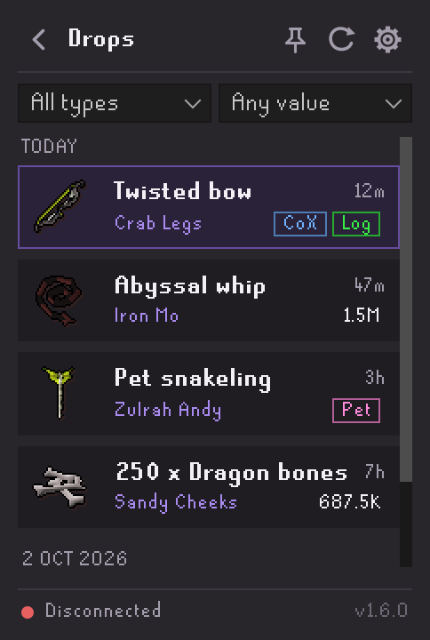

## News

The **News** section lists announcements from the clan admins, pinned ones first. A pin marks pinned posts, a green dot marks ones you haven't read, and the **News** tile on the home screen shows how many are new. Each new announcement appears in your chatbox once, when you log in or when it's posted. Links in an announcement show the full address and ask before opening in your browser. Turn that off with **Clan announcements** under **Chat** in the plugin settings.

## Split view

Click the pin icon on **Members**, **Parties** or **Drops** to dock it below the main view, then open an event or anything else above it. Drag the divider to resize, click the dock's bar or arrow to collapse it to a single row, and click **✕** to unpin. One section can be pinned at a time, and the dock remembers its size and what's pinned.

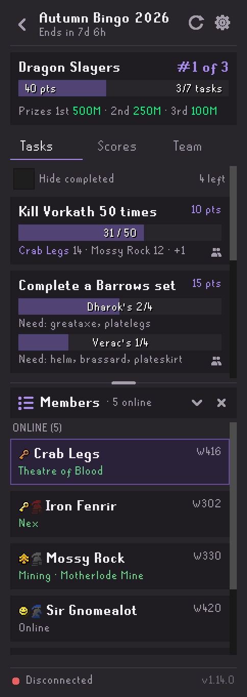

---

## Link your Discord

Every clan member can link their RuneScape account to the clan Discord:

1. Click **Link Discord** at the bottom of the TSG Hub home screen, with sharing on. It copies a `/plugin link code:...` command and opens the clan Discord.
2. Paste the command in the clan Discord. The plugin fills in **Hub key** under **Discord** in its settings by itself within a few seconds.

You can also run `/plugin link` without a code. The bot replies with a key that starts with `tsghub_` for you to paste into **Hub key** yourself.

The plugin confirms the key in the sidebar and links your Discord account to the character you're logged in as. Using the same key on your alts links them too. A name change carries over automatically next time you log in. The key renews itself while you use it. If it stops working, or you lose it, click **Link Discord** again (it shows whenever your key is missing or rejected); `/plugin unlink` disables it and unlinks your account.

## For admins

Admin tools use the same hub key. If you're a Discord admin (the server owner, a member with an admin role, or anyone with Manage Server), linking gives you a key with admin access. Keys from before hub keys existed, starting with `tsgadm_`, keep working and move into the **Hub key** setting by themselves.

Once the key checks out, an admin button appears in the sidebar header. It opens the TSG Hub admin site in your browser, already signed in. That's where you create and edit events, teams and tasks, review results, post announcements, and manage members. `/admin login` in the clan Discord gives you the same one-time link. If you lose your Discord admin role, your key keeps linking your account but the admin button disappears.

Your in-game clan rank doesn't grant admin access. Owners and Deputy Owners keep admin access through their Discord admin role.

---

## Privacy

TSG Hub is **opt-in**. Until you click **Enable sharing** (or turn on **Share game and clan progress** in the plugin settings), it sends nothing.

Once you opt in, it sends the following to the TSG Hub service:

- Your RuneScape display name, and the clan name and rank your client detects
- If you've set a hub key, the key with your display name and RuneLite account hash when the plugin checks it, to link your Discord account to this character and follow name changes
- Your sign-up note, if you sign up for a bingo's team pool. Admins see it on the admin site while picking teams
- Progress for events you've joined: kill counts, drops, raid completions, collection log unlocks and skill XP
- Loot you receive while a bingo event you've joined is active, so admins can reconcile a task from earlier drops if its item list changes
- Your boss kill count messages and the loot you receive, even outside events, so the clan Discord can post a summary of each boss session. The service keeps only the running session, not a history
- Your skill XP totals as they change, even outside events. The service keeps the XP you gain per skill per day for a year, for clan XP leaderboards
- Whether you're currently in the clan chat channel and your world, so teammates' completion alerts reach you and clanmates see you as online
- With **Share location and activity** on, your area name, current activity and world map position (except inside instances)
- All clan and personal broadcast messages
- When you open the Clan Coffer, its coin total, and each change while it stays open: deposit or withdrawal, the balance before and after, and whether a coffer chat message showed you made it. Only clan admins can see this, on the admin site. The plugin doesn't show it

In a clan party, your stats, gear and inventory go to the other members through **RuneLite's party service**, not the TSG Hub service. The TSG Hub service only learns your display name, party and world, plus your area name and position if location sharing is on.

Turning sharing off, or disconnecting from an event, deletes your local token and asks the service to revoke it. Progress your team already earned stays with the clan.

Clan membership, rank and progress are reported by each player's client. They're useful for convenience checks, but a modified client can fake them, so admins should double-check high-stakes results. Admin access comes only from Discord-issued hub keys whose holder is a Discord admin, never from the reported rank.

## Credits

The live party member panels are adapted from [Party Panel](https://github.com/TheStonedTurtle/party-panel) by TheStonedTurtle, under the BSD 2-Clause license. See [THIRD_PARTY_NOTICES.md](THIRD_PARTY_NOTICES.md).

TSG Hub is licensed under the [BSD 2-Clause License](LICENSE).
